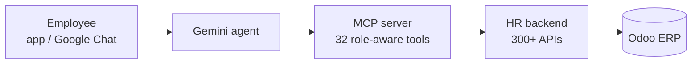

# Hi, I'm Anas 👋

I build AI agents that do real work inside real businesses.

The hardest part of an AI agent usually isn't the model. It's everything around it: permissions, audit trails, access tokens that expire halfway through a conversation, and a voice agent that has to say "ten thousand" instead of "one zero zero zero zero". That's the part I enjoy.

## What I've shipped

**AI HR agent + MCP server** · in production
Employees chat with an agent, in our app or in Google Chat, to check attendance and file leave, expense and missing-punch requests. Under the hood: a Gemini agent, a 32-tool MCP server, and an HR backend with 300+ endpoints on top of Odoo ERP. Every action runs under the employee's own identity, with hashed API keys, tool allowlists and a full audit log.

**Voice AI analytics agent** · a bilingual Urdu/English voice agent (Gemini Live) and chat-driven dashboards over enterprise ERP data in BigQuery, with each user's data scope enforced at the tool level.

**AI CV parser & semantic search** · Gemini turns PDF and DOCX CVs into structured profiles (99 of 100 real CVs parsed), with embedding search and LLM reranking. I cut latency from ~17s to ~4s.

These live in private company repos, so the code isn't public, but I'm happy to walk through the architecture.

## Lately I've been working on

- MCP servers and the security around them: per-user identity, tool allowlists, audit logs
- Voice agents with Gemini Live, in Urdu and English
- RAG and semantic search that holds up on real, messy documents
- Shipping with Claude Code as part of my everyday workflow

## Side projects

| Project | What it is | Stack |
|---|---|---|
| [FastAPI-Blog-App](https://github.com/AnasAshfaq20/FastAPI-Blog-App) | Full-stack blog with JWT auth, S3 uploads, async PostgreSQL and a test suite | FastAPI · SQLAlchemy · AWS S3 |
| [Expense-Manager](https://github.com/AnasAshfaq20/Expense-Manager) | Backend for a React Native expense tracker | FastAPI · PostgreSQL |

## A bit about me

- AI Engineer in Lahore, Pakistan
- Claude Certified Architect – Foundations (Anthropic)
- Company Excellence Award '26 for building our employee self-service platform
- Toolbox: Python · FastAPI · Flask · MCP · LangChain · LangGraph · RAG · Gemini · Claude · PostgreSQL · MySQL · BigQuery · Docker · Google Cloud

If you're building agents for real business systems, I'd love to compare notes: [LinkedIn](https://www.linkedin.com/in/anas-ashfaq-chaudary)
