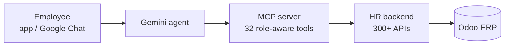

### Hi there, I'm Anas 👋

**AI Engineer** at [TallyMarks Consulting](https://tallymarksconsulting.com/) — I build AI agents that do real work inside real businesses.

       

## About Me

- 🔭 I'm currently building AI agents and MCP servers that run in production
- 🤖 Shipped an AI HR agent: a Gemini agent + a 32-tool MCP server + an HR backend with 300+ APIs on top of Odoo ERP
- 🎙️ Built a bilingual Urdu/English voice agent with Gemini Live
- 📄 Built AI CV parsing and semantic search with Gemini (99 of 100 real CVs parsed)
- 🌱 Currently exploring LangGraph and multi-agent patterns
- 🏆 Claude Certified Architect – Foundations (Anthropic) · Company Excellence Award '26
- 💬 Ask me about MCP, RAG, voice agents and FastAPI
- ⚡ Fun fact: one of my favourite bugs was a voice agent reading 10,000 as "one zero zero zero zero"

## How my AI HR agent works

## Side projects

| Project | What it is | Stack |
|---|---|---|
| [FastAPI-Blog-App](https://github.com/AnasAshfaq20/FastAPI-Blog-App) | Full-stack blog with JWT auth, S3 uploads, async PostgreSQL and a test suite | FastAPI · SQLAlchemy · AWS S3 |
| [Expense-Manager](https://github.com/AnasAshfaq20/Expense-Manager) | Backend for a React Native expense tracker | FastAPI · PostgreSQL |

## Let's Connect

 

