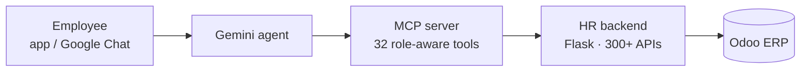

# Hi, I'm Anas

**AI Engineer** building agentic AI systems that run in production: MCP servers, voice agents and RAG on top of real business software.

Claude Certified Architect – Foundations (Anthropic) · Lahore, Pakistan

## What I've built at work (private repos)

**AI HR Agent, MCP Server & HR Platform Backend** · in production
An AI agent employees chat with to check attendance and file leave, expense and missing-punch requests. It runs on a 32-tool MCP server and a Flask API with 300+ endpoints on top of Odoo ERP. Every action runs under the employee's own identity, with hashed API keys, tool allowlists and a full audit log.

**Voice AI Analytics Agent** · bilingual Urdu/English voice agent (Gemini Live) and chat-driven dashboards over enterprise ERP data in BigQuery, with each user's data scope enforced at the tool level.

**AI CV Parser & Semantic Search** · Gemini turns PDF/DOCX CVs into structured profiles (99/100 real CVs parsed), with embedding search and LLM reranking; latency cut from ~17s to ~4s.

## Public projects

| Project | What it is | Stack |
|---|---|---|
| [WhatsApp-Bot](https://github.com/AnasAshfaq20/WhatsApp-Bot) | Multi-channel AI booking agent for WhatsApp, Instagram and Messenger, with voice notes in and out | FastAPI · Groq · Whisper · PostgreSQL |
| [FastAPI-Blog-App](https://github.com/AnasAshfaq20/FastAPI-Blog-App) | Full-stack blog with JWT auth, S3 uploads, async PostgreSQL and a test suite | FastAPI · SQLAlchemy · Alembic · AWS S3 |
| [Expense-Manager](https://github.com/AnasAshfaq20/Expense-Manager) | Backend for a React Native expense tracker | FastAPI · PostgreSQL |

## Stack
Python · FastAPI · Flask · MCP · LangChain · LangGraph · RAG · Gemini · Claude · PostgreSQL · MySQL · BigQuery · Docker · Google Cloud

## Find me
[LinkedIn](https://www.linkedin.com/in/anas-ashfaq-chaudary)
